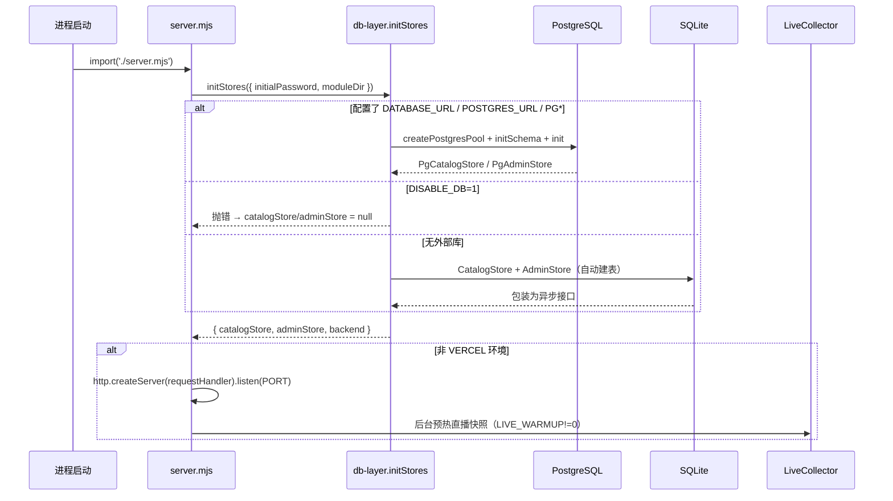
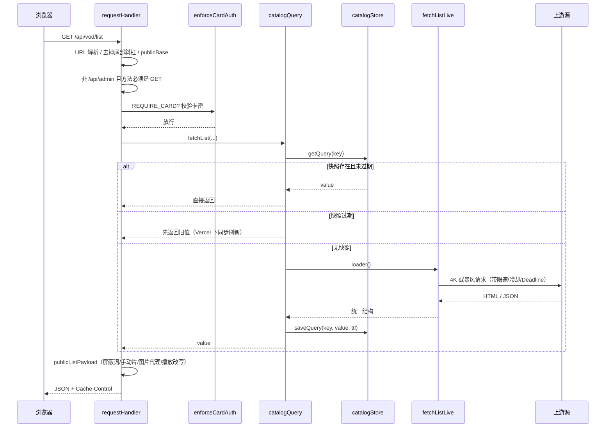
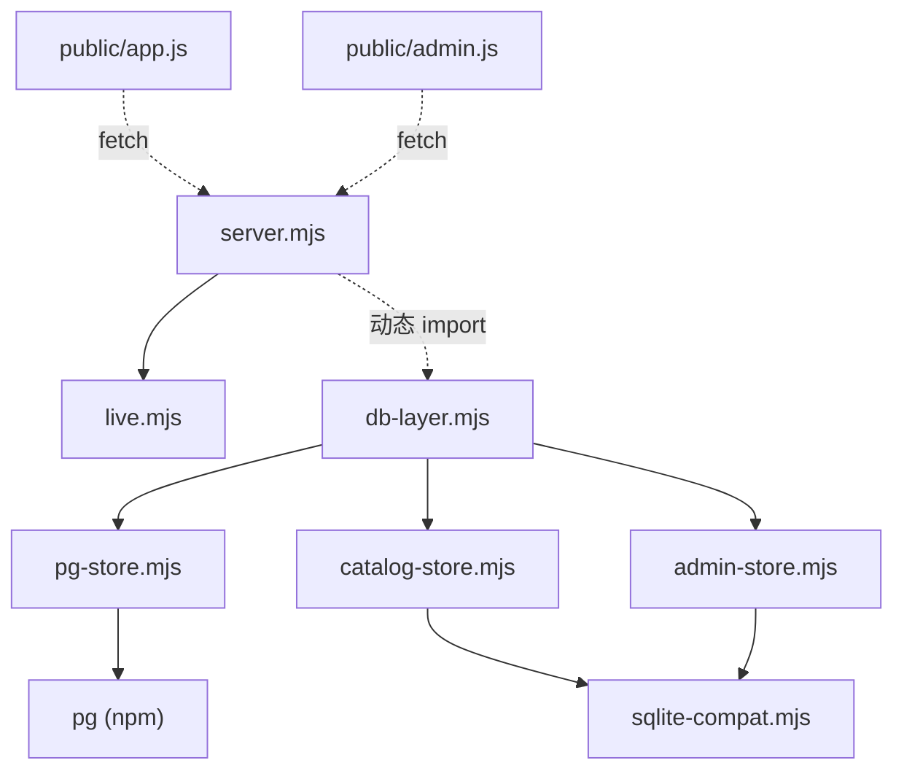

# 01 · 整体架构

## 1. 分层视图

项目只有一个 Node.js 进程（或一个 Vercel 函数入口），内部按职责分为五层：

| 层 | 代码位置 | 职责 |
| --- | --- | --- |
| 接入层 | [server.mjs](../../dyrs-vod-web/server.mjs) `requestHandler` | HTTP 解析、路由分发、CORS、压缩、缓存头、静态文件 |
| 业务层 | `server.mjs` 中部函数 | 列表/搜索/详情、榜单、推荐、频道、播放解析、直播、后台 |
| 上游适配层 | `server.mjs` 内的 `fetchFourk*` / `fetchBfzy*` / `fetchDouban*` / `fetchKan*`；`live.mjs` | 把不同上游的 HTML/JSON/M3U 统一成 MacCMS 结构 |
| 存储层 | `db-layer.mjs` + `pg-store.mjs` / `catalog-store.mjs` / `admin-store.mjs` | 查询快照、影片元数据、站点设置、广告、卡密、会话 |
| 表现层 | `public/` | 原生 JS 单页前台 + 后台，无构建步骤 |

`server.mjs` 是唯一的编排中心：它既负责业务判断，也负责调用适配器和存储层。没有额外的 service/repository 分层，阅读时以函数为边界即可。

## 2. 启动流程



关键点：

- 存储初始化失败**不会阻止服务启动**，只是 `catalogStore` / `adminStore` 为 `null`，此时后台与持久化功能降级，实时抓取仍然可用（[server.mjs L16-33](../../dyrs-vod-web/server.mjs#L16-L33)）。
- SQLite 路径优先取 `VOD_DB_PATH`，否则应用目录下 `data/catalog.db`；目录不可写时回退系统临时目录（[db-layer.mjs L73-85](../../dyrs-vod-web/db-layer.mjs#L73-L85)）。
- Vercel 环境不自行 `listen`，由平台调用默认导出的 `requestHandler`（[server.mjs L2947-2965](../../dyrs-vod-web/server.mjs#L2947-L2965)）。

## 3. 请求生命周期

以一次前台列表请求 `GET /api/vod/list?t=1&pg=1` 为例：



## 4. 双源故障链

目录、搜索、详情、播放解析采用统一顺序：

```text
4kcz.com → czzy.top → cz4k.com → bfzy1.tv → bfzy2.tv → bfzy3.tv → bfzy4.tv → bfzy5.tv
```

实现上分为两段：

- 4K 段：[`withFourkHosts()`](../../dyrs-vod-web/server.mjs#L867-L898) 遍历 `FOURKCZ_HOSTS`，每个主机独立 Deadline；HTML 校验失败、被 WAF 拦截、结构缺失都会抛 `upstreamFailure`，触发冷却后切下一个镜像。
- 暴风段：[`upstreamJson()`](../../dyrs-vod-web/server.mjs#L606-L650) 遍历 `UPSTREAM_HOSTS`，非 2xx / 非 JSON 即冷却并切换。

上层 [`fetchListLive()`](../../dyrs-vod-web/server.mjs#L1089-L1107) 决定先走 4K 还是直接走暴风：

| 场景 | 路由决策 |
| --- | --- |
| 一级分类 `1–5` 且无年份 | 优先 4K（`FOURKCZ_CATEGORY_PATHS` 支持的分类） |
| 年份筛选 | 直接暴风（4K 无法表达年份） |
| 二级 MacCMS `type_id`（如 21/24/31） | 直接暴风（4K 只有一级栏目） |
| 综艺 / 短剧 / 预告片 / 体育 | 4K 无对应路径 → 暴风 |
| 最新 / 最热 / 高分推荐 | 豆瓣榜单；失败回退上游排序 |
| 4K 失败 | 同一请求内回退暴风 |

**不能忽略筛选条件**：年份、二级分类等 4K 无法表达的条件必须走暴风，而不是丢弃条件返回 4K 数据。

## 5. 缓存体系

### 5.1 进程内 Map 缓存

| 缓存 | 位置 | Key | TTL |
| --- | --- | --- | --- |
| 暴风 JSON | `jsonCache` / `inflightJson` | `bfzy:<query>` | 列表 15min / 详情 30min |
| 4K 结果 | `fourkCache` / `inflightFourk` | `list:*` / `search:*` / `detail:*` / `play:*` | 同上，播放页为 0 |
| 跨源配对 | `pairCache` | `f|b:<片名>:<年份>` | 30min |
| 播放解析 | `PLAY_URL_CACHE` / `PLAY_URL_INFLIGHT` | `<id>:<seq>` | 5min |
| 360kan 片名解析 | `KAN_TITLE_CACHE` | 规范化片名 | 进程生命周期 |
| 屏蔽词/手动片 | `insightCache` | 单例 | 30s（后台修改后主动失效） |

### 5.2 数据库快照

所有列表/搜索/详情查询都抽象成 `{ page, pagecount, total, list }` 快照，由 [`catalogQuery()`](../../dyrs-vod-web/server.mjs#L1206-L1235) 统一处理：

1. 有快照且新鲜 → 直接返回；
2. 有快照但过期 → 非 Vercel 后台单并发刷新；Vercel 同步刷新后返回（避免实例回收丢失结果）；
3. 无快照 → 先尝试本地库 `localLoader`（如搜索、频道），没有则实时抓取并写库。

查询键由 [`listCacheKey()`](../../dyrs-vod-web/server.mjs#L1237-L1242) 等函数生成，必须包含 `pg/t/year/withPlay` 等全部条件，避免不同筛选串数据。

### 5.3 边缘 CDN 缓存

[`sendJsonCacheable()`](../../dyrs-vod-web/server.mjs#L204-L221) 同时输出：

- `Cache-Control: public, max-age=..., s-maxage=..., stale-while-revalidate=...`
- `Cloudflare-CDN-Cache-Control`（让 Cloudflare 在 Vercel 之后仍能缓存）

授权模式（`REQUIRE_CARD=1`）下 `s-maxage` 会被压到 60 秒，避免过期卡密命中旧缓存。直播分组/频道接口与播放解析故意使用 `no-store` 或短缓存。

## 6. 分类与 ID 映射

### 6.1 一级分类

`CATEGORIES`（[server.mjs L133-144](../../dyrs-vod-web/server.mjs#L133-L144)）包含：

| id | 名称 | 来源 |
| --- | --- | --- |
| `new` / `hot` / `score` | 最新 / 最热 / 高分推荐 | 豆瓣榜单（失败回退上游排序） |
| `1` | 电影 | 4K `/movie_bt_series/dyy` 或暴风 |
| `2` | 电视剧 | 4K 合并 `guochanju/mj/hj/rj` 或暴风 |
| `3` | 综艺 | 暴风 |
| `4` | 动漫 | 4K `/movie_bt_view_cat/fjj` 或暴风 |
| `5` | 短剧 | 暴风 |
| `6` | 预告片 | 暴风 |
| `7` | 体育 | 暴风 |

`PROVIDER_TYPES`（[L52-60](../../dyrs-vod-web/server.mjs#L52-L60)）定义每个一级分类对应的 MacCMS 子分类 ID，`TYPE_NAMES`（[L69-76](../../dyrs-vod-web/server.mjs#L69-L76)）提供中文名。

### 6.2 ID 约定

| 来源 | 格式 | 校验正则 |
| --- | --- | --- |
| 4K | `4kcz-<1~8 位数字>` | `/^4kcz-\d{1,8}$/` |
| 暴风 | 纯数字（1~10 位） | `/^\d{1,10}$/` |
| 手动影片 | `manual-<4~24 位小写字母数字>` | `/^manual-[a-z0-9]{4,24}$/` |

不同来源的 ID 绝不会传给对方适配器：`fetchDetailLive()`、`detailForPlay()`、`resolvePlayback()` 都先按前缀分流。

## 7. 模块依赖关系



- `server.mjs` 对 `db-layer.mjs` 使用**动态 import + try/catch**，保证存储不可用时服务仍能启动。
- `server.mjs` 对 `live.mjs` 是静态 import（直播采集器在模块加载时创建）。
- `catalog-store.mjs` 与 `admin-store.mjs` 共用同一个 SQLite 文件，但各自建表，互不依赖。
- `pg-store.mjs` 复制了 SQLite 版的清洗/评分/卡密语义，保证两种后端行为一致。

## 8. 关键设计约束（长期不变）

来自 [AGENTS.md](../../AGENTS.md) 与代码实现，修改时需保持：

1. 源站停运、被拦截、返回非 HTML、关键结构缺失，一律视为故障并切换源，**不伪造成功数据**。
2. 只从 4K 播放页提取 `mysvg` / `art.url` 字符串，**不执行上游 JavaScript**。
3. 播放/媒体/播放器 URL 只信任配置源站与可信 CDN（`py1080p.com`、`4kcz.com`、`czzy.top`、`cz4k.com`、`bytetos.com`、`bytedtos.com`），防 SSRF。
4. 播放地址、播放页、短期 m3u8 **不入库**；`detailForPlay()` 必须实时采集。
5. 只维护 PostgreSQL 与 SQLite 两种存储实现，不新增其他数据库后端。
6. 前台展示的线路名统一为「趣影一线/二线…」，不暴露上游线路标识。
7. 后台修改类接口校验同源 Origin，缺失或跨站直接 403。
8. 未匹配的 `/api/*` 必须返回 JSON 404，不能落到首页 HTML。
