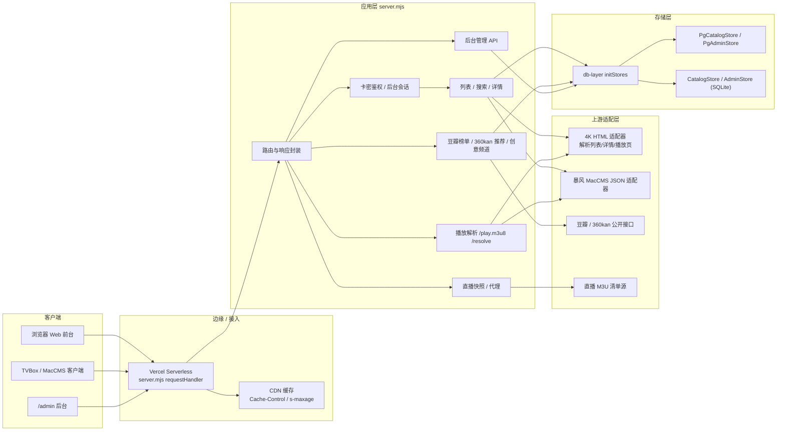

# 趣影（quying-vod）Code Wiki

> 面向开发者的项目源码说明，覆盖整体架构、模块职责、关键类与函数、依赖关系、运行与部署方式。
> 文档基于工作区当前代码整理，代码行号以各文件实际内容为准。

## 1. 项目是什么

趣影（仓库目录 `dyrs-vod-web`，线上项目 `quying-vod`）是一个**影视聚合服务**：

- 把 `4kcz.com`（线路一，镜像 `czzy.top`、`cz4k.com`）的公开 HTML 页面和 `bfzy1–5.tv`（线路二）的 MacCMS JSON API，适配成统一的 **TVBox / MacCMS 兼容片库**；
- 只读取源站公开页面，**不保存、不转存影片文件**；
- 播放时实时解析短时有效的 `m3u8` 地址，并且播放地址**不入库**；
- 附带直播聚合、豆瓣榜单、360kan 推荐、创意频道、卡密授权与后台管理。

一句话：**一个 Node.js 原生 HTTP 服务 + 单页前端，把两类上游影视源包装成统一 API、Web 站点与 TVBox 配置。**

## 2. 技术栈

| 类别 | 选型 |
| --- | --- |
| 运行时 | Node.js 20+（推荐 24+；线上 Vercel 使用 Node 26） |
| Web 服务 | Node 内置 `http` / `https`，无 Express/Koa |
| 持久化 | PostgreSQL（`pg`，Vercel + Neon）优先；否则本地 SQLite（`node:sqlite`） |
| 前端 | 原生 JavaScript（IIFE）+ 原生 CSS，零框架、零打包 |
| 直播播放 | 浏览器原生 HLS 或按需加载 `hls.js` |
| 部署 | Vercel Serverless（`server.mjs` 默认导出）；本地 `run.sh` / `npm start` |
| 定时采集 | GitHub Actions（`.github/workflows/collect.yml`）调用 `/api/admin/collect` |

## 3. 文档目录

| 文档 | 内容 |
| --- | --- |
| [01-architecture.md](./01-architecture.md) | 整体架构、请求生命周期、双源故障链、缓存体系、模块依赖 |
| [02-server-core.md](./02-server-core.md) | `server.mjs` 路由表、响应封装、鉴权/CSRF、后台接口、核心工具函数 |
| [03-upstream-adapters.md](./03-upstream-adapters.md) | 4K HTML 适配器、暴风 MacCMS 适配器、豆瓣榜单、360kan 推荐、创意频道、播放解析 |
| [04-storage-layer.md](./04-storage-layer.md) | 存储工厂、SQLite / PostgreSQL 双实现、表结构、数据清洗与查询键 |
| [05-live-streaming.md](./05-live-streaming.md) | 直播采集、频道分类合并、冷启动保护、代理与前端播放器 |
| [06-frontend-admin.md](./06-frontend-admin.md) | 前台 `app.js`、后台 `admin.js`、页面结构与交互契约 |
| [07-config-deploy-testing.md](./07-config-deploy-testing.md) | 环境变量、运行/构建/部署、测试清单、工具脚本与排障 |

## 4. 系统架构一图速览



## 5. 核心概念速查

| 概念 | 说明 |
| --- | --- |
| 线路一 / 趣影一线 | 暴风源 `bfzy1–5.tv`（MacCMS JSON API） |
| 线路二 / 趣影二线 | 4K 源 `4kcz.com` 及镜像（HTML 页面） |
| ID 约定 | 4K 影片为 `4kcz-<数字>`，暴风为纯数字，手动影片为 `manual-<hash>`；不同源 ID 不得混传 |
| 统一故障链 | 目录/搜索/详情/播放解析：`4kcz → czzy.top → cz4k → bfzy1 → … → bfzy5`，单源 5 秒 Deadline |
| 播放地址 | 短期有效，只做实时解析 + 5 分钟进程内缓存，**绝不入库** |
| 持久化内容 | 仅影片目录、详情、剧集**元数据**与查询快照；播放 URL、播放器 URL 会被清洗掉 |
| 卡密授权 | 默认关闭；`REQUIRE_CARD=1` 时受保护接口需带卡密，首次访问自动核销 |
| 缓存 TTL | 列表 15 分钟、详情 30 分钟、TVBox 配置 1 小时；直播快照默认 6 小时 |

## 6. 快速开始

```bash
cd dyrs-vod-web
npm install
npm start            # 默认 http://0.0.0.0:8000
```

可选：

```bash
PORT=8022 npm start                    # 指定端口
DISABLE_DB=1 npm start                 # 禁用数据库，全部实时回源（后台不可用）
DATABASE_URL=postgres://... npm start  # 使用 PostgreSQL
node --test                            # 运行单元/集成测试
```

详细配置见 [07-config-deploy-testing.md](./07-config-deploy-testing.md)。

## 7. 关键入口文件

| 文件 | 职责 |
| --- | --- |
| [server.mjs](../../dyrs-vod-web/server.mjs) | 全部路由、上游适配、播放解析、直播路由、后台接口；默认导出 `requestHandler` |
| [live.mjs](../../dyrs-vod-web/live.mjs) | 直播 M3U 解析、频道分类合并、`LiveCollector` 快照 |
| [db-layer.mjs](../../dyrs-vod-web/db-layer.mjs) | 存储工厂 `initStores()`：PostgreSQL 优先，SQLite 回退 |
| [pg-store.mjs](../../dyrs-vod-web/pg-store.mjs) | PostgreSQL 目录库与后台库 |
| [catalog-store.mjs](../../dyrs-vod-web/catalog-store.mjs) | 本地 SQLite 目录库 |
| [admin-store.mjs](../../dyrs-vod-web/admin-store.mjs) | 本地 SQLite 后台库（设置/广告/卡密/会话） |
| [sqlite-compat.mjs](../../dyrs-vod-web/sqlite-compat.mjs) | `node:sqlite` 驱动封装 |
| [public/app.js](../../dyrs-vod-web/public/app.js) | 前台单页应用 |
| [public/admin.js](../../dyrs-vod-web/public/admin.js) | 后台单页应用 |
| [vercel.json](../../dyrs-vod-web/vercel.json) | Vercel 函数与静态资源缓存配置 |
